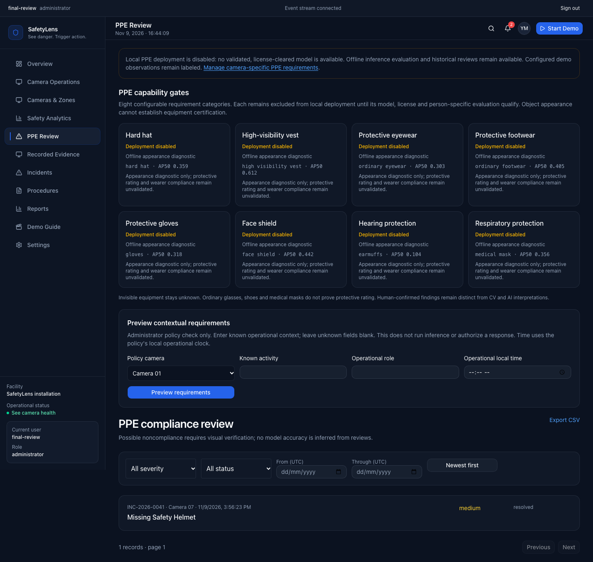
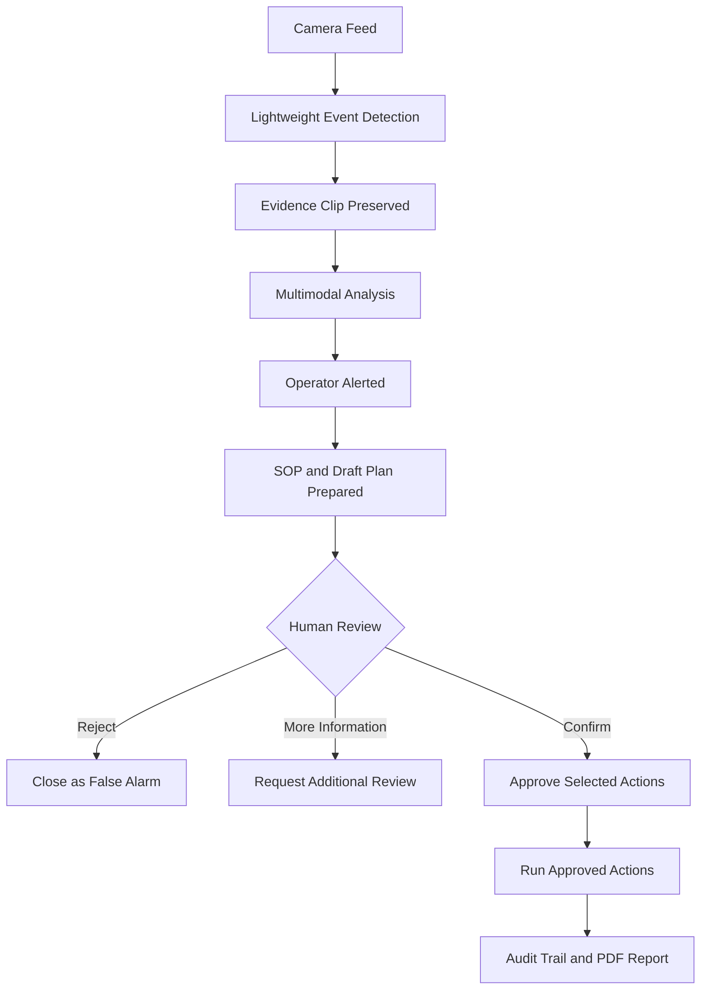

# SafetyLens

**Computer vision evidence. Human-supervised response.**

> 🏆 **1st Place — The Executable World Hackathon | $25,000 Prize**
>
> SafetyLens secured first place among 384 participants at The Executable World Hackathon, earning a $25,000 prize.

Team-reported achievement; [evidence and attribution](docs/README_RESTORATION.md) distinguish contributor reports from organizer corroboration.

SafetyLens connects camera observations to protected evidence, cited safety procedures, operator review and auditable simulated response. It combines applied computer vision with the software controls needed to investigate uncertain model outputs.

## Capabilities

- **Vision:** MediaPipe pose, temporal fall rules, optional multi-person histories, and a hash-pinned causal learned classifier for research.
- **PPE research:** actual nine-class ONNX appearance inference, independently verified label provenance and exclusive person association. Eight contextual protective requirements have explicit deployment gates.
- **Reliable transport:** recorded/webcam/network inputs, bounded live-frame buffering, camera health, persistent retries, clip checksums and UUID deduplication.
- **Incident workflow:** evidence playback, optional multimodal interpretation, lexical SOP retrieval, exact citations, human confirmation/selected approval, simulated actions and PDF/CSV audit exports.
- **Secure operations:** role-based sessions, CSRF/origin checks, scoped device access, encrypted camera sources, bounded uploads, versioned edits and PostgreSQL recovery.

## Evaluation scope

The frozen learned profile detected **4/4 falls** and alerted on **10/14 non-fall clips** in the published 18-recording test (precision .286, F1 .444). It remains opt-in because false-alert burden is unacceptable. This small recording split does not establish subject-disjoint generalization. No further test-set tuning was performed.

PPE appearance diagnostics cover 100 images with unknown training overlap; independent wearer/protective-rating accuracy is unmeasured. All eight PPE deployment gates remain closed. Historical equipment scores using the wrong mirror label map are withdrawn and corrected transparently.

**Research release, not certified workplace safety equipment or a replacement for professional monitoring.** Human review is required; all external response actions are simulated. The authoritative [frozen metrics](docs/FINAL_PROJECT_METRICS.md) provide results, test counts, provenance and claim boundaries.

## Application



Actual local interface: appearance diagnostics, disabled deployment gates and administrator policy resolution.


Actual evidence review, approval and simulated response. [Recorded inference demo](docs/DEMO_GUIDE.md).

<details>
<summary>Additional application and original staged screenshots</summary>


Original staged demonstration, preserved unchanged:


</details>

## Architecture

Next.js/React/TypeScript · FastAPI/Pydantic/SQLAlchemy · PostgreSQL/SQLite · OpenCV/MediaPipe/ONNX Runtime · Docker/Alembic/Playwright.

Local CV findings, optional LLM interpretation, configured demonstrations and human decisions retain separate provenance. Planning uses stored procedures and deterministic templates; model text cannot approve actions. The original workflow diagram remains below; “Run Approved Actions” means simulation, and multimodal analysis is optional.



[Component boundaries and security model](docs/ARCHITECTURE.md).

## Quick start: local Docker

First installation only; requires Python3 and Docker Compose. Secret generation refuses overwriting an existing file.

```sh
mkdir -p "$HOME/.config/safetylens"
python3 scripts/prepare_local_env.py --output "$HOME/.config/safetylens/local.env"
docker compose --env-file "$HOME/.config/safetylens/local.env" -f docker-compose.yml -f docker-compose.postgres.yml up --build -d
docker compose --env-file "$HOME/.config/safetylens/local.env" -f docker-compose.yml -f docker-compose.postgres.yml exec backend python -m app.manage create-user --username operator
```

Open [localhost:3000](http://localhost:3000). No default password exists. This is a loopback HTTP profile. Preserve existing secrets/volumes; nonlocal HTTPS and site-specific safety/privacy qualification require separate work.

[Host development and exact dependencies](docs/REPRODUCIBILITY.md) · [Camera setup and real inference](docs/CAMERA_PIPELINE.md) · [Docker verification](docs/DEPLOYMENT_VERIFICATION.md).

## Test and reproduce

```sh
backend/.venv/bin/python -m pytest -c backend/pytest.ini backend/tests -q
PYTHONPATH=detector/src backend/.venv/bin/python -m unittest discover -s detector/tests -q
npm --prefix frontend run lint
npm --prefix frontend run typecheck
npm --prefix frontend run build
npm --prefix frontend run test:e2e
python3 scripts/freeze_project_metrics.py --check
```

Browser delivery is synthetic by default; [set actual-model variables](docs/REPRODUCIBILITY.md) to run real inference. Regression tests are separate from detection accuracy. [Fall evaluation](docs/FALL_DETECTION_EVALUATION.md) · [PPE evaluation](docs/PPE_EVALUATION.md) · [Final validation](docs/FINAL_VALIDATION_REPORT.md) · [Security](docs/SECURITY.md).

## Team and acknowledgments

- **Yug More** — [GitHub](https://github.com/Yug-More): backend, application workflows and integration in the historical team plan.
- **Sean Aminov** — [GitHub](https://github.com/SeanAminov): original pose/video detector, temporal algorithm and evidence buffering.
- **Abhinav GS** — [GitHub](https://github.com/Abhinavgs1): original demo support, guide and manual QA.

Human authorship and original assets remain intact. [Historical project material](docs/HISTORICAL_README.md) · [Graduate application summaries](docs/GRADUATE_APPLICATION_SUMMARY.md) · [Documentation index](docs/README.md).

## License and data

Model/data rights are separate from application code. URFall and SH17 research data carry noncommercial restrictions; the evaluated SH17 export carries AGPL metadata. No footage or weights are bundled. [Model provenance and obligations](docs/MODEL_REGISTRY.md). Vendored shadcn stylesheet retains its [MIT license and attribution](frontend/src/styles/vendor/shadcn/LICENSE.md).
