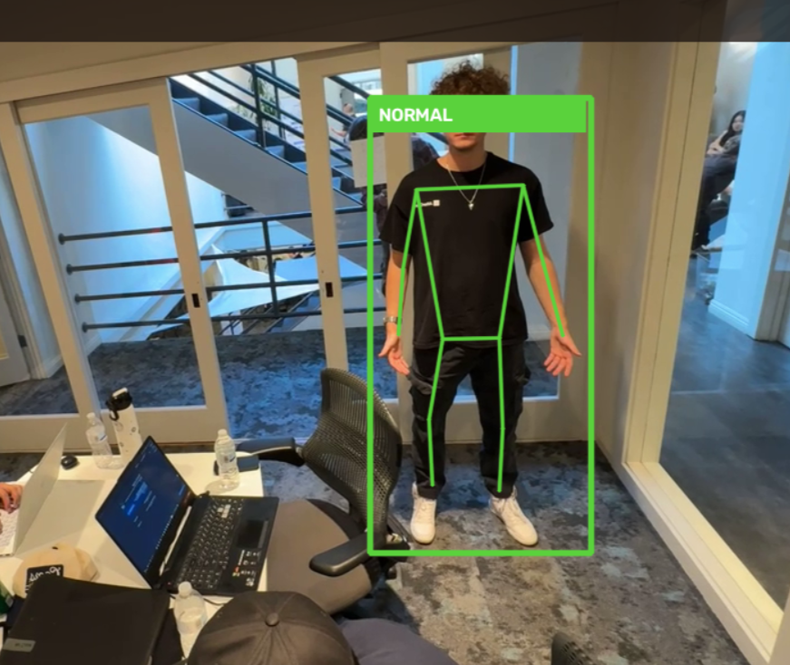
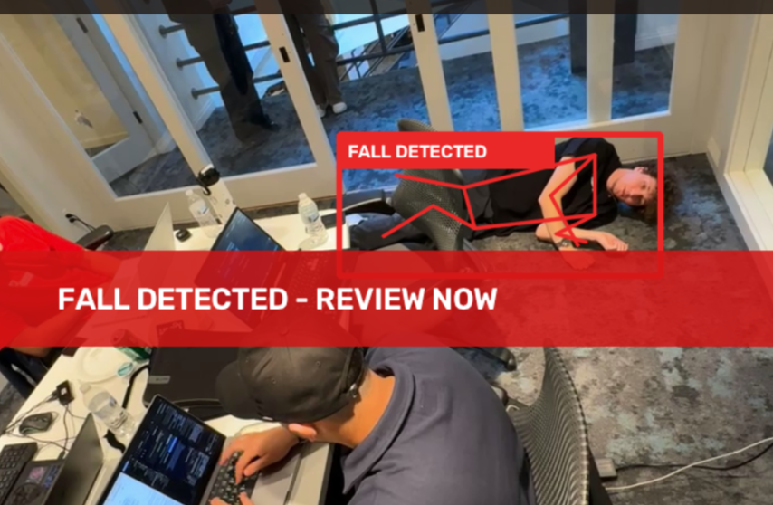
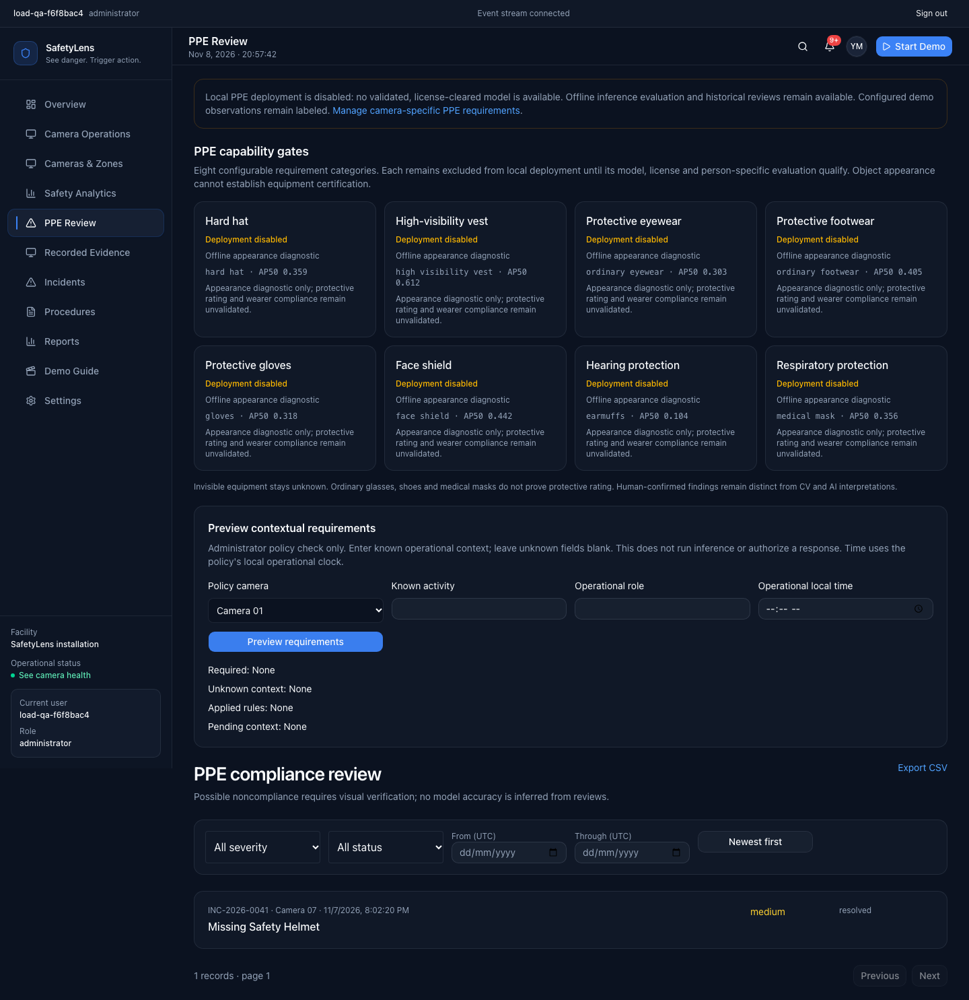
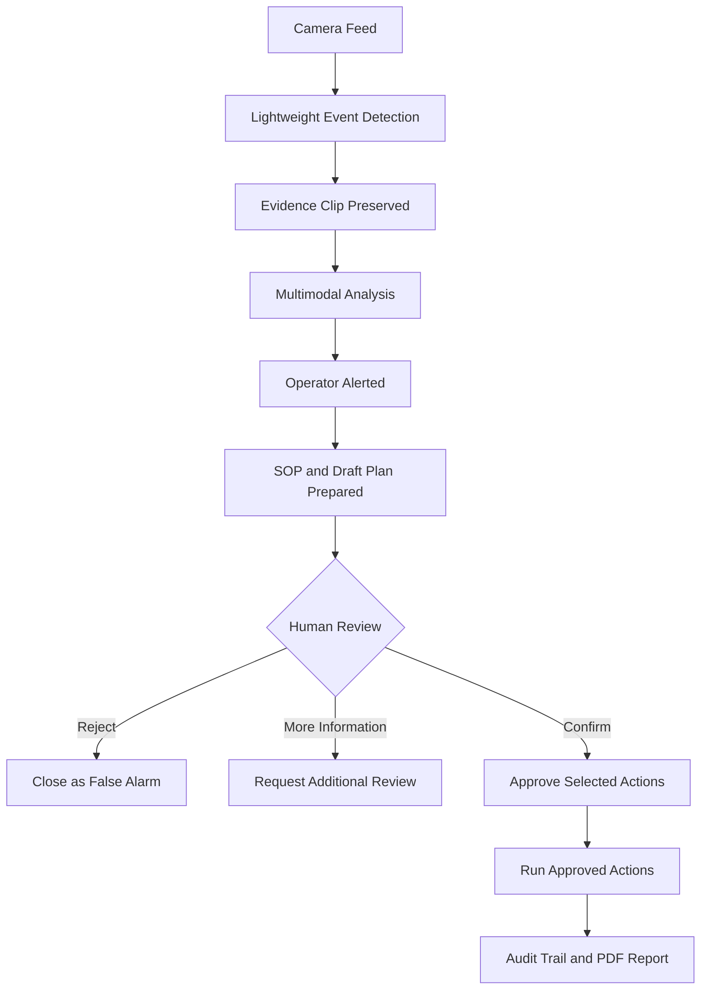
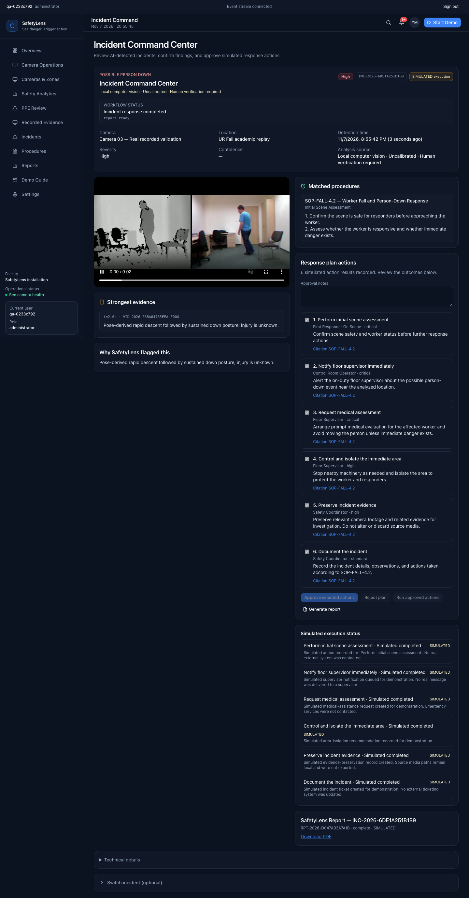
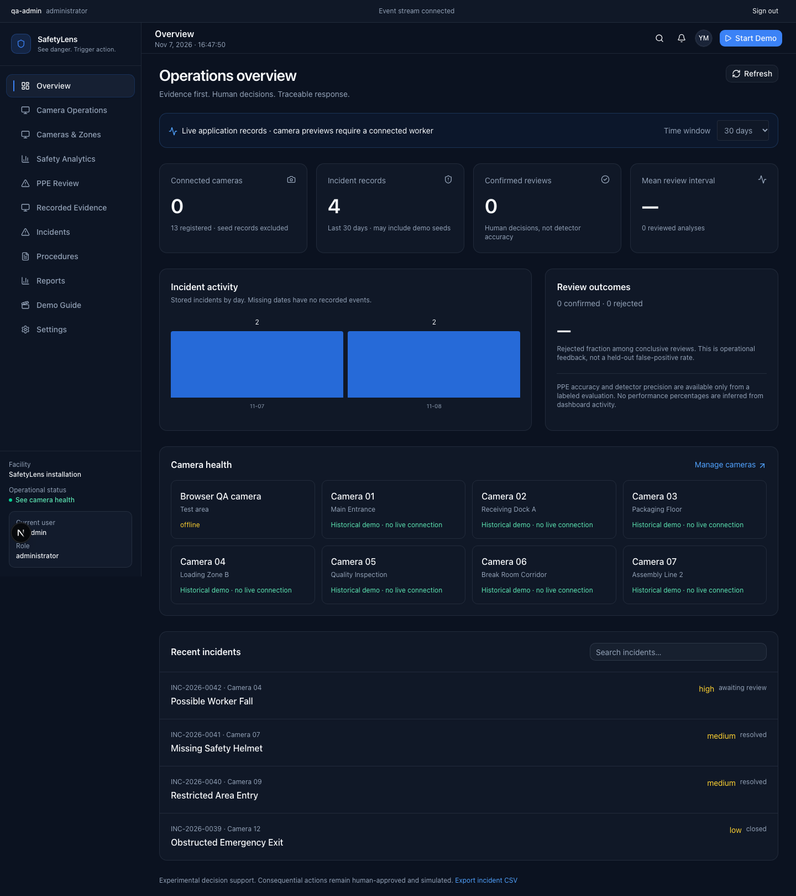
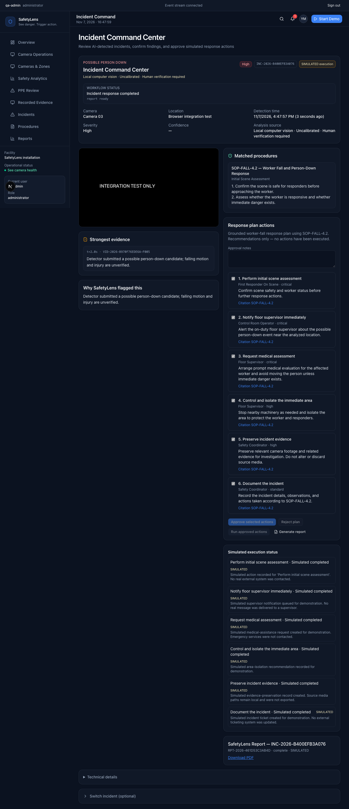

# SafetyLens

> 🏆 **1st Place — The Executable World Hackathon | $25,000 Prize**
>
> SafetyLens secured first place among 384 participants at The Executable World Hackathon, earning a $25,000 prize.

**Computer vision evidence. Human-supervised response.**

SafetyLens connects local camera observations, preserved incident evidence, optional multimodal investigation, company procedures, explicit human approval, and traceable simulated response. It is an experimental applied-AI platform, not a certified safety or medical system.

The original hackathon implementation and contributor history are preserved. Team members reported first place at The Executable World Hackathon; competition recognition does not validate detector performance. See [historical project documentation](docs/HISTORICAL_README.md) and [historical baseline](docs/HISTORICAL_BASELINE.md).

## The Problem

Most workplaces already have security cameras, but these cameras primarily record footage for review after an incident.

When an emergency occurs:

- Someone must notice the correct camera at the correct time.
- Relevant footage must be located and preserved manually.
- Employees must search for the appropriate safety procedure.
- Supervisors must coordinate the response across disconnected tools.
- Incident reports must be prepared afterward.

These delays can increase operational risk, response time, and administrative cost.

## Our Solution

SafetyLens connects camera evidence, multimodal reasoning, company procedures, human approval, and incident reporting into one continuous workflow:

**camera event → AI investigation → operator alert → human review → policy-grounded action → auditable report**

The system automates investigation and response preparation while preserving human authority over incident confirmation and consequential actions.

---


## Live Sensing Capabilities

The original staged demonstration continuously senses body posture and movement from a live camera feed. Its temporal detector distinguishes normal activity from a sustained person-down event, giving the operator a simple green or red status while preserving the evidence around an incident.

| Normal activity | Staged fall alert |
| --- | --- |
|  |  |
| Full-body pose tracking follows the person while the detector reports **NORMAL**. | A sustained fall changes the tracked state to **FALL DETECTED** and calls for human review. |

---


## Historical hackathon demonstration

The primary dashboard scenario is a possible person-down event assigned to the seeded Camera 03 — Warehouse Aisle. The live screenshots above show a staged demonstration in a meeting room.

1. A recorded Camera 03 event is submitted to SafetyLens.
2. The video is automatically prepared and analyzed.
3. SafetyLens identifies a possible person-down event.
4. The safety operator receives an immediate alert.
5. The Incident Command Center opens the correct video and evidence.
6. The relevant person-down procedure is prepared.
7. The operator confirms or rejects the incident.
8. Selected actions require explicit approval.
9. Approved actions execute in simulation.
10. SafetyLens records the audit trail and generates a PDF report.

The repository also includes a PPE review workflow with camera-specific requirements, configured demo observations, and provider-assisted analysis. It is separate from the local fall detector and is not a continuously running PPE detection model. Fire, smoke, and restricted-zone detection remain future work.

---


## Enhanced platform

- Local MediaPipe pose estimation and temporal event logic, with a preserved legacy profile and conservative fall/person-down interpretation.
- Actual offline nine-class ONNX appearance inference, verified category provenance and person-specific association/abstention. Eight protective requirement categories remain **deployment-disabled**; appearance is not equipment certification.
- Opt-in causal pose learning with train/validation/test separation, compact linear/neural comparisons and explicit rejection of default promotion after excessive fresh-test false alarms.
- Contextual PPE requirements per camera/zone, supplied activity/role/time, and an administrator preview that preserves unknown context.
- Automatic authenticated detector delivery through a bounded persistent SQLite outbox, retry/backoff and UUID acknowledgement/deduplication.
- Camera registration/editing, facility/zone grouping labels, encrypted private sources, per-camera policies, heartbeat health and labeled latest-image previews.
- Secure-by-default local users, scrypt passwords, revocable sessions, CSRF/Origin checks and administrator/manager/operator/viewer roles.
- Operations overview, camera operations, searchable/paginated incident history, PPE review, data-backed analytics and versioned operator notes.
- Resumable database-backed SSE updates; explicit unavailable/empty states instead of silent mock success.
- Evidence-frame/clip investigation, optional OpenAI image-and-text analysis, lexical SOP retrieval and exact citation snapshots.
- Separate incident confirmation and selected-action approval; retry authorization checks; simulated-only execution; audited PDF/CSV reporting.
- H.264 playback derivatives preserve original evidence. Scoped retention can expire resolved media while keeping metadata/audit history.
- Additive Alembic migration, optional PostgreSQL Compose path, non-root containers, locked dependencies, CI and browser workflow tests.

## Actual detection evidence

The original **12-clip** external check detected 2/6 falls; those results remain preserved. Diagnosing its misses exposed a composite depth/RGB input error and a temporal-state bug. After freezing explicit RGB calibration and the state fix, **20 additional clips** gave TP8/FN2/FP2/TN8 (precision .8, recall .8, F1 .8), compared with TP5/FN5/FP2/TN8 (F1 .5882) for the preserved pre-change configuration on the same clips. No thresholds were lowered or tuned on the new set. These are small video-presence measurements with unknown subject separation and no independently annotated onsets.

A subsequently frozen evaluation on recordings 17–26 gives a more cautious result: on camera 0, **TP4/FN6/FP1/TN9, precision .80, recall .40, F1 .5333**. The preserved original configuration scored F1 .3077 on the same clips. Camera 1 detected 4/10 falls; no camera-1 negative set was available. Paired camera views are not independent events. Publisher-onset matching gives a mean 1.258 s annotation-to-rule delay among the four detected camera-0 falls; six misses remain. This is offline timing, not notification latency. The earlier 20 clips are now development data, not a reusable holdout.

The detector remains **unsuitable for unattended workplace safety**. Intentional reclining, short falls, occlusion and camera geometry remain failure modes. **Earlier PPE equipment metrics are withdrawn:** original publisher annotations exposed a numeric category remapping in the third-party mirror. Corrected results and an independent 1,172-box provenance check are in [PPE_EVALUATION.md](docs/PPE_EVALUATION.md). Local PPE deployment is enforced disabled. See [detection validation](docs/DETECTION_VALIDATION.md), [PPE findings](docs/PPE_VALIDATION.md), [performance](docs/PERFORMANCE_REPORT.md) and the [final report](docs/FINAL_RELEASE_REPORT.md) for raw evidence, source hashes, uncertainty and limitations.

## Current research results

A new causal temporal model was selected on development recordings, then frozen before 18 fresh camera-0 clips. It detected **4/4 falls but falsely alerted on 10/14 negatives** (precision .286, F1 .444). The existing rules detected 0/4 with eight negative alerts on the same clips. This sensitivity/false-alarm tradeoff prevents promotion; four positive recordings cannot establish reliable recall. Subject/session separation is unknown. [Fall protocol and raw results](docs/FALL_DETECTION_EVALUATION.md).

The official SH17 ONNX export was evaluated on 100 fixed, semantically verified images: person recall .818/AP50 .785; helmet recall .425/AP50 .359; vest recall .767/AP50 .612. These are **appearance diagnostics with unknown training overlap**, not wearer compliance or protective-rating accuracy. All eight deployment gates remain closed. [Class-by-class evaluation](docs/PPE_EVALUATION.md).



Actual Docker-served interface: labeled appearance metrics, disabled protective-class gates and an administrator policy preview. No live PPE deployment is implied.

Current verification: **92 backend, 66 detector and 9 actual-model browser cases passed**, plus frontend lint/typecheck/standalone Docker build, PostgreSQL 17 migration/restart and an actual learned-event review-to-PDF workflow. These tests establish tested engineering behavior, not detector reliability. [Final validation](docs/FINAL_VALIDATION_REPORT.md) · [Reproduce experiments](docs/REPRODUCIBILITY.md) · [Demo guide](docs/DEMO_GUIDE.md) · [Graduate application summary](docs/GRADUATE_APPLICATION_SUMMARY.md).

## Architecture

Camera → local pose inference → temporal event → pre/post evidence → durable device outbox → authenticated FastAPI ingestion → local-CV analysis/incident → notification → evidence review → stored SOP retrieval → cited response draft → human confirmation/approval → simulated actions → audit/report.

Uploaded video can instead use explicitly scripted Demo AI or configured OpenAI image/text analysis. Real detector imports are not silently passed through scripted analysis. Planning currently uses deterministic policy templates, including the historical OpenAI compatibility setting; no external LLM planning call is implied.

Frontend: Next.js/React/TypeScript/Tailwind/Base UI/shadcn components. Backend: FastAPI/Pydantic/SQLAlchemy/SQLite. Optional PostgreSQL path. Vision: OpenCV, MediaPipe, ONNX Runtime. Infrastructure: Docker Compose, Alembic, pytest/unittest/Playwright. See [architecture](docs/ARCHITECTURE.md).

The original system diagram is preserved below. “Approved Execution” currently means simulated actions; local CV and optional provider analysis are separate paths.





Actual local Docker workflow screenshot; source research footage is attributed in [asset notes](docs/assets/enhanced/README.md).

## Local setup

Use Python 3.12 and Node 22+. Keep existing private environment files unchanged.

```sh
python3.12 -m venv backend/.venv
backend/.venv/bin/python -m pip install -r backend/requirements.lock.txt
cd backend
# Create .env from .env.example only on first setup.
.venv/bin/python -m alembic -c alembic.ini upgrade head
.venv/bin/python -m app.seed.run  # Optional historical demo data
.venv/bin/python -m app.manage create-user --username YOUR_USERNAME
.venv/bin/python -m uvicorn app.main:app --host 127.0.0.1 --port 8000
```

In another terminal: `cd frontend && npm ci && npm run dev`. Open [localhost:3000](http://localhost:3000). On first setup copy `frontend/.env.example` to `.env.local` if no private configuration exists. The browser-facing API defaults to `http://localhost:8000` even when uvicorn binds `127.0.0.1`; do not mix browser hostnames because strict cookies require the same site. There is no default password. API/frontend origins and hostnames must match the configured allowed origins for cookie authentication.

## Cameras and live detection

Register a camera in Cameras & Zones, configure private server-side encryption/device credentials, and follow [CAMERA_PIPELINE.md](docs/CAMERA_PIPELINE.md). Run the detector in its separate environment using `detector/requirements-video.lock.txt`. Download model weights explicitly; no model is bundled or downloaded at startup. CPU pose inference was tested on the Mac host, but still required an OS graphics context.

```sh
PYTHONPATH=detector/src detector/.venv/bin/python -m safetylens_detector.worker \
  --backend http://127.0.0.1:8000 --camera-ids CAMERA_UUID \
  --pose-model /path/pose_landmarker_lite.task
```

Supply DETECTOR_API_TOKEN privately in the worker environment and scope it with server DETECTOR_CAMERA_IDS. Remote delivery requires HTTPS. Camera previews are labeled snapshots/replays, not a claimed high-FPS live-video gateway. Original webcam preview commands remain in [detector/README.md](detector/README.md).

## Verification

```sh
backend/.venv/bin/python -m pytest -c backend/pytest.ini backend/tests -q
PYTHONPATH=detector/src backend/.venv/bin/python -m unittest discover -s detector/tests -v
npm --prefix frontend run lint
npm --prefix frontend run typecheck
npm --prefix frontend run build
npm --prefix frontend run test:e2e
```

Browser tests generate isolated credentials/databases and exercise playback/review/approval/PDF without external messages. The default delivery fixture is synthetic; set `SAFETYLENS_REAL_CLIP` and `SAFETYLENS_POSE_MODEL` to run actual inference, as used in current verification. Synthetic integration fixtures are not detection-evaluation data. [TESTING.md](docs/TESTING.md) and [RELEASE_VERIFICATION.md](docs/RELEASE_VERIFICATION.md) record actual results and unfinished work.

## Deployment and safeguards

`docker compose up --build` is the local HTTP profile; bootstrap an administrator interactively. See [DEPLOYMENT.md](docs/DEPLOYMENT.md) for production flags and the optional PostgreSQL path. The full frontend/backend/PostgreSQL 17 Compose profile was built and verified, including actual-model evidence playback, human approval, simulated response, PDF generation, service/database restart and isolated backup restoration. This establishes a local reproducible deployment, not an industrial deployment; see [deployment verification](docs/DEPLOYMENT_VERIFICATION.md).

Never place secrets in NEXT_PUBLIC variables or Git. Evidence/report access is authenticated; private camera sources are encrypted. Retention runs are explicit and scoped. No facial recognition, identity inference or employee productivity scoring. All consequential action execution remains simulated; no emergency services, messaging platform or physical equipment is contacted.

## Limitations and future work

Low measured recall; no disjoint PPE benchmark; unresolved reference-model license; experimental opt-in multi-pose tracking (up to four people, default one); no production camera-fleet benchmark; no browser video gateway/overlay transport; no tenant isolation or face blurring; no external dispatch; no certified audit ledger. These are research/engineering tasks, not hidden capabilities. See [SECURITY.md](docs/SECURITY.md), [MODEL_REGISTRY.md](docs/MODEL_REGISTRY.md), [platform audit](docs/PLATFORM_AUDIT.md) and [changelog](docs/CHANGELOG.md).

## Team and historical work

- **Yug More** — [GitHub](https://github.com/Yug-More) — backend, primary application workflows and integration (historical team plan).
- **Sean Aminov** — [GitHub](https://github.com/SeanAminov) — original pose/video detector, temporal algorithm and detector evidence work.
- **Abhinav GS** — [GitHub](https://github.com/Abhinavgs1) — original demo support, guide and manual QA.

Enhancement commits preserve existing authorship and do not reattribute earlier contributions. Original screenshots remain under `docs/assets/demo/`; original screens remain under `/demo`, `/demo/incidents`, `/demo/settings`.

## Enhanced application screenshots

Actual local browser-test captures, with seeded demonstration records clearly separated from real detector validation.





## Original local live-preview demonstration

The original separate pose-preview process remains available, preserving the hackathon demonstration:

```sh
PYTHONPATH=detector/src detector/.venv/bin/python -m safetylens_detector.live --source 0 --model /path/pose_landmarker_lite.task --mirror
```

The original demo used a Camo phone at camera index 1; indices and permissions vary. Keep the person and floor visible; press Q to stop. Local preview alone does not imply backend delivery. The enhanced worker connects delivery automatically. Historical PPE/demo statements above describe the hackathon configuration; current ONNX PPE adapters are offline evaluation tools with local deployment disabled.

For the actual recorded-video-to-report test, set `SAFETYLENS_REAL_CLIP` and `SAFETYLENS_POSE_MODEL` as described in [end-to-end verification](docs/END_TO_END_VERIFICATION.md). Without them the default browser fixture is explicitly synthetic. See [final release report](docs/FINAL_RELEASE_REPORT.md) for acceptance gates and unresolved blockers.
